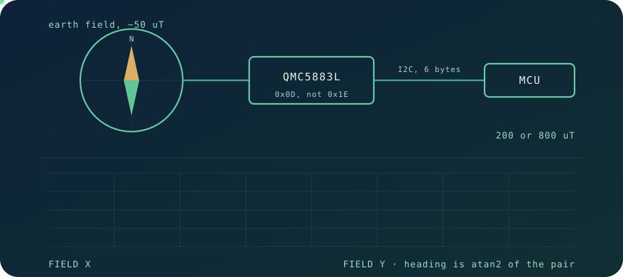

<p align="center">
  
</p>

# mcu-compass

<p align="center">
  
  
  
</p>

A small C magnetometer library for **ESP-IDF 5.2+** and **STM32 HAL (F4/F7)**.
Five chip drivers share one API for timestamped magnetic-field samples in
microtesla, board-axis mapping, and a heading helper. This library replaces
`esp-compass` and `stm-compass`.

The repository is named `mcu-compass`; the C API, `CONFIG_COMPASS_*` options,
and forge package key remain `compass`. The clone command below keeps the
ESP-IDF component directory named `compass` as well.

> **Hardware unverified.** Host tests use simulated devices and platform stubs.
> Nothing here has run on a physical chip.

[Supported hardware](#supported-hardware) · [Drivers](#drivers) ·
[Install](#install) ·
[Quick start](#quick-start) · [Examples](#examples) ·
[Documentation](#documentation) · [Tests](#tests)

## Supported hardware

All five drivers support both platforms. Enable only the drivers you need.

| Chip | Bus | Notes |
|---|---|---|
| **QMC5883L** | I2C | QST 3-axis magnetometer |
| **QMC5883P** | I2C | QST 3-axis magnetometer |
| **IST8310** | I2C | iSentek 3-axis magnetometer |
| **LIS3MDL** | I2C or SPI | ST 3-axis magnetometer |
| **CMPS14** | UART | Robot Electronics tilt-compensated compass |

Unsure which chip your GY-271 carries? Start with the `gy271` example and
[identification guide](docs/hardware.md#which-chip-is-on-my-gy-271).
HMC5883L is not supported.

## Drivers

<details><summary><b>QMC5883L</b> — I2C</summary>

Fixed address `0x0D`; found on GY-271 boards.

- Examples (detect QMC5883P or QMC5883L on GY-271): ESP-IDF
  [gy271](examples/esp/gy271/) · STM32 HAL [gy271](examples/stm/gy271/main.c)
- Examples: ESP-IDF [qmc5883l](examples/esp/qmc5883l/) · STM32 HAL
  [qmc5883l](examples/stm/qmc5883l/main.c)
- Chip reference: [QMC5883L](docs/chips.md#qmc5883l)

</details>

<details><summary><b>QMC5883P</b> — I2C</summary>

Fixed address `0x2C`; a different chip and register map from the L.

- Examples (detect QMC5883P or QMC5883L on GY-271): ESP-IDF
  [gy271](examples/esp/gy271/) · STM32 HAL [gy271](examples/stm/gy271/main.c)
- Examples (including self-test): ESP-IDF [qmc5883p](examples/esp/qmc5883p/) ·
  STM32 HAL [qmc5883p](examples/stm/qmc5883p/main.c)
- Chip reference: [QMC5883P](docs/chips.md#qmc5883p)

</details>

<details><summary><b>IST8310</b> — I2C</summary>

Addresses `0x0C`–`0x0F`; default `0x0E`.

- Examples: ESP-IDF none · STM32 HAL [ist8310](examples/stm/ist8310/main.c)
- Chip reference: [IST8310](docs/chips.md#ist8310)

</details>

<details><summary><b>LIS3MDL</b> — I2C or SPI</summary>

Separate probes for each bus.

- Examples: none.
- Chip reference: [LIS3MDL](docs/chips.md#lis3mdl)

</details>

<details><summary><b>CMPS14</b> — UART</summary>

Serial mode only; module provides calibration and tilt-compensated bearing.

- Examples: none.
- Chip reference: [CMPS14](docs/chips.md#cmps14)

</details>

## Install

### ESP-IDF

Clone into your project's components directory:

```sh
git clone https://github.com/JonasAtelier/mcu-compass components/compass
```

Enable your chips in `idf.py menuconfig` → **Component config → Compass
(magnetometer) subsystem**, or add this to `sdkconfig.defaults` for QMC5883P:

```ini
CONFIG_COMPASS=y
CONFIG_COMPASS_QMC5883P=y
```

The `main` component sees the library automatically. Other components declare
`REQUIRES compass driver` in `idf_component_register()`.

### esp-forge / stm-forge

stm-forge must be at `ee921c3` or later, which builds the chip folders in
`src/`; older ones fail at link with undefined chip probes.

Add to `profiles/pkgversion`:

```make
compass_GIT=https://github.com/JonasAtelier/mcu-compass@stable
```

Enable the package and your chip in `configs/<target>_defconfig`:

```make
PKG_compass        = y
COMPASS_QMC5883P   = y
```

### STM32 HAL without forge

Compile every `.c` under `src/`, chip folders included, add `include/` and
`src/` to the include path, and define
`CMSIS_device_header` as your family header (`"stm32f4xx.h"` or
`"stm32f7xx.h"`), `USE_HAL_DRIVER`, and `CONFIG_COMPASS_<CHIP>=1` for each
selected chip. Enable and compile its required HAL modules.

**No chip driver is enabled by default.** See the
[installation guide](docs/installation.md) for all chip options, HAL module
requirements, float logging, and linking `libm`.

## Quick start

Initialise the bus in your application, then probe the sensor, wait for a
fresh measurement, and read a sample. This STM32 helper assumes the passed
I2C handle is already initialised. It polls for up to 200 ms, allowing time
for the QMC5883P's default 10 Hz measurement rate:

```c
#include <errno.h>
#include <stdbool.h>

#include "compass.h"
#include "compass_log.h"
#include "qmc5883p.h"

int read_once(I2C_HandleTypeDef *bus)
{
    struct compass_dev compass = { 0 }; /* Must start zeroed. */
    struct compass_sample sample;
    bool ready = false;
    int ret = qmc5883p_probe(&compass, bus, NULL);
    if (ret)
        return ret;

    for (unsigned int attempt = 0; attempt < 20; ++attempt) {
        HAL_Delay(10);
        ret = qmc5883p_data_ready(&compass, &ready);
        if (ret || ready)
            break;
    }
    if (!ret)
        ret = ready ? compass_read(&compass, &sample) : -ETIMEDOUT;
    if (!ret)
        compass_log_sample(&compass, &sample);

    qmc5883p_remove(&compass);
    return ret;
}
```

Call `read_once(&hi2c1)` from thread context. On ESP-IDF, use an
`i2c_master_bus_handle_t` and a FreeRTOS task delay; the
[QMC5883P example](examples/esp/qmc5883p/main/main.c) shows both.
For continuous sampling, probe once, poll and read in your loop, and remove
when finished.

- `compass_read()` returns board-frame X/Y/Z in **µT**, plus `t_us`.
- Integer-returning API calls return **0 or a negative errno**. Use a sample
  only on success; errors leave it unchanged.
- Set `compass.mount` to map chip axes into board axes; all zero means identity.
- `compass_heading_deg()` expects **X right, Y forward, Z up**, with the board
  flat. Apply calibration and local declination for a useful heading.

See [API usage and heading](docs/usage.md) for device lifetime, timestamps,
axis mapping, calibration, logging, and error codes.

## Examples

Each driver's examples are listed under [Drivers](#drivers).

ESP-IDF examples already locate this library through `EXTRA_COMPONENT_DIRS`.
With ESP-IDF activated, build from an example directory:

```sh
cd examples/esp/qmc5883p
idf.py set-target esp32 # Replace with your board's target.
idf.py build
```

STM32 examples are snippets
to integrate into your application, with clock setup and logging retargeting
provided by you. Check the example's pin definitions against your board and
read the [wiring guide](docs/hardware.md).

## Scope and limitations

The library provides a shared sample format and synchronous chip drivers.
Your application owns bus setup, scheduling, and locking.

- **Calibration and tilt compensation:** the core does neither. Apply your own
  corrections before calculating heading. CMPS14 supplies its own calibrated
  field and a separate tilt-compensated bearing API.
- **Blocking bus calls:** no interrupt-driven transfers, FIFO, or DMA support.
- **Concurrency:** use one thread per device and bus handle, or supply a mutex.
- **STM32 timestamps:** the default clock has millisecond resolution and wraps
  after 49.7 days. Override `compass_time_us()` if needed.

## Documentation

| Guide | Contents |
|---|---|
| [Installation](docs/installation.md) | Forge, ESP-IDF, STM32 HAL, build options and logging setup |
| [Hardware](docs/hardware.md) | GY-271 identification, wiring and pull-ups |
| [API usage and heading](docs/usage.md) | Lifecycle, timing, mounting, calibration and errors |
| [Chip reference](docs/chips.md) | Ranges, defaults, self-tests, protocol details and datasheet assumptions |
| [Development](docs/development.md) | Platform ports, bus abstraction, adding a driver and test coverage |

Public interfaces live in [include/](include/); chip drivers and platform ports
live in [src/](src/). The [repository layout](docs/development.md#repository-layout)
maps every directory and the file-naming rule for chip folders.

## Tests

```sh
make -C test test
```

Host-only tests use stubbed HAL and ESP-IDF APIs; no embedded toolchain or
physical sensor is needed. See the [test reference](docs/development.md#tests)
for compiler requirements and coverage. Error logs during the suite are
expected: tests deliberately exercise failure paths.

## License

[MIT](LICENSE)
